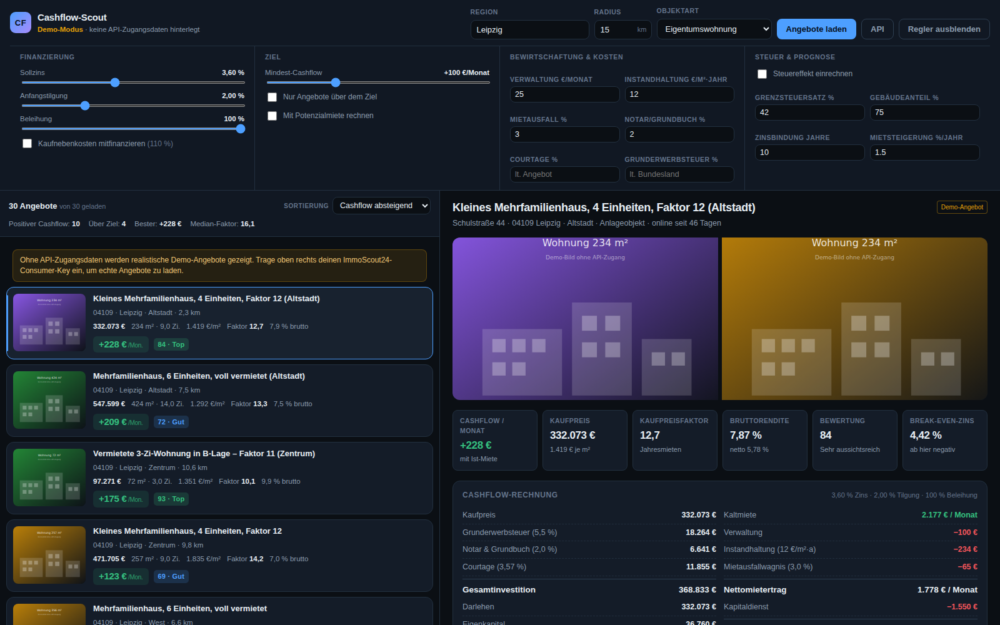

# Cashflow-Scout

Vergleichsoberfläche für ImmoScout24-Angebote aus Sicht eines Kapitalanlegers:
links die Angebote zum Durchscrollen mit dem Cashflow direkt an der Karte,
rechts die Analyse mit Pluspunkten, Minuspunkten und den Zahlen dahinter.
Zinssatz, Tilgung, Beleihungsgrad und Ziel-Cashflow sind Regler in der Kopfzeile
— jede Änderung rechnet alle Angebote sofort neu durch.



## Schnellstart

```bash
npm start          # startet auf http://localhost:3000
npm test           # 32 Tests für Finanzmathematik, Analyse und API-Normalisierung
```

Ohne API-Zugangsdaten startet die Anwendung im **Demo-Modus** mit realistischen
Beispielangeboten. Die gesamte Oberfläche und alle Berechnungen funktionieren
dort identisch — nur die Daten sind erfunden.

## API-Zugang einrichten

Die Suche greift auf die [ImmoScout24 REST-API](https://api.immobilienscout24.de)
zu. Zugang gibt es nur als Content-Partner; für die Suche genügt
Zwei-Bein-OAuth mit Consumer Key und Secret.

Entweder über den Knopf **API** oben rechts eintragen (schreibt auf Wunsch nach
`.env.local`, die von `.gitignore` erfasst ist), oder manuell:

```bash
cp .env.example .env.local
# IS24_CLIENT_KEY und IS24_CLIENT_SECRET eintragen
```

Der Dialog testet die Zugangsdaten sofort mit einer Minimalsuche und meldet
zurück, ob die Verbindung steht.

## Was gerechnet wird

Grundlage ist die klassische Annuitätenrechnung für vermietete Wohnimmobilien:

| Größe | Rechnung |
| --- | --- |
| Kaufnebenkosten | Grunderwerbsteuer (aus der PLZ je Bundesland) + Notar/Grundbuch + Courtage (aus dem Exposé, sonst Fallback) |
| Darlehen | Beleihungsgrad × Kaufpreis, auf Wunsch inklusive Nebenkosten (110-%-Finanzierung) |
| Annuität | (Sollzins + Anfangstilgung) × Darlehen |
| Bewirtschaftung | Verwaltung + Instandhaltungsrücklage (€/m²·Jahr) + Mietausfallwagnis + nicht umlagefähiger Hausgeldanteil |
| **Cashflow** | Kaltmiete − Bewirtschaftung − Annuität |
| Steuereffekt (optional) | (Miete − Bewirtschaftung − Zins − AfA) × Grenzsteuersatz |

Zusätzlich ausgewiesen: Kaufpreisfaktor, Brutto- und Nettomietrendite,
Eigenkapitalrendite, Kapitaldienstdeckung (DSCR), Restschuld am Ende der
Zinsbindung, der **Break-even-Zins** (ab wann der Cashflow kippt) und der
**maximale Kaufpreis**, bei dem das Cashflow-Ziel noch aufgeht — letzteres als
Verhandlungsgrundlage.

### Mieten

Bei vermieteten Objekten wird die Ist-Miete aus dem Exposé verwendet. Fehlt sie,
schätzt die Anwendung sie aus einem regionalen Mietniveau (Stadtwert, sonst
PLZ-Gebiet) mit Zu- und Abschlägen für Wohnfläche, Baujahr und Zustand. Solche
Angebote sind in der Liste als *Miete geschätzt* markiert.

Die Marktmiete wird **nicht** auf mindestens die Ist-Miete angehoben. Liegt die
Bestandsmiete über dem Marktniveau, erscheint das als Warnung — beim
Mieterwechsel fällt der Cashflow dann.

> Die Mietwerte sind Orientierungsgrößen für den Vergleich, kein Mietspiegel.
> Vor einer Kaufentscheidung gehören sie gegen den örtlichen Mietspiegel geprüft.

## Was analysiert wird

Die Bewertung (0–100) kombiniert Textregeln auf dem Exposé mit den
strukturierten Feldern und den errechneten Kennzahlen:

- **Risiken aus dem Text:** Sanierungs- und Renovierungsbedarf, Erbbaurecht,
  Nießbrauch und Wohnrecht, Sonderumlagen und Instandhaltungsstau, Schadstoffe
  und Feuchteschäden, veraltete Heizungen, Souterrainlage, Lärm,
  Zwangsversteigerung, Teileigentum.
- **Pluspunkte:** Kernsanierung, Neubau, moderne Energieversorgung,
  Provisionsfreiheit, laufende Vermietung, Staffel- oder Indexmiete, Stellplatz,
  Aufzug, gute Anbindung.
- **Aus den Feldern:** Baujahr, Energieeffizienzklasse (notfalls aus dem
  Kennwert abgeleitet), fehlender Energieausweis.
- **Aus den Kennzahlen:** Ziel-Cashflow erreicht, Kaufpreisfaktor,
  Bruttorendite gegen das Zinsniveau, Zinspuffer, Mietsteigerungspotenzial,
  Höhe der Kaufnebenkosten.

Jeder Punkt nennt die Konsequenz, nicht nur das Stichwort — inklusive grober
Renovierungsbudgets nach €/m².

Die Skala endet bewusst bei 3 und 97: eine Textanalyse kann ein Objekt weder
freisprechen noch endgültig verurteilen. Sie ersetzt keine Besichtigung, keine
Teilungserklärung und kein Protokoll der Eigentümerversammlung.

## Bedienung

- **Regler oben** wirken sofort auf alle Angebote — Zins, Tilgung, Beleihung,
  Ziel-Cashflow, Bewirtschaftungskosten, Steuer.
- **„Nur Angebote über dem Ziel"** blendet alles aus, was dein Ziel verfehlt.
  Bleibt nichts übrig, zeigt die Anwendung, wie weit das beste Objekt entfernt
  ist und bei welchem Zins es aufginge.
- **„Mit Potenzialmiete rechnen"** legt statt der Ist-Miete die geschätzte
  Marktmiete zugrunde.
- **Pfeiltasten oder `j`/`k`** blättern durch die Liste.
- Einstellungen bleiben im Browser gespeichert.

## Aufbau

```
server/       HTTP-Server ohne externe Abhängigkeiten
  index.js      Routen und Auslieferung
  is24Client.js Suche und Exposé-Abruf
  oauth1.js     OAuth-1.0a-Signierung (HMAC-SHA1)
  normalize.js  IS24-JSON → einheitliches Angebotsmodell
  demoData.js   Beispielangebote für den Betrieb ohne Zugang
shared/       läuft in Node und im Browser
  finance.js    Annuität, Cashflow, Kennzahlen, Prognose
  analysis.js   Regelwerk für Pro-/Contra-Punkte und Score
  regions.js    Bundesländer, Grunderwerbsteuer, Mietniveau, Städte
public/       Oberfläche (Vanilla-JS-Module, kein Build-Schritt)
test/         Tests über Node's eingebauten Test-Runner
```

Es gibt bewusst keine Laufzeit-Abhängigkeiten und keinen Build-Schritt:
`node server/index.js` genügt.

Die Suche lädt die Ergebnisliste und reichert bis zu sechs Exposés parallel an,
damit Beschreibungstexte, Baujahr, Energieausweis und Hausgeld für die Analyse
zur Verfügung stehen. Schlägt ein Exposé-Abruf fehl, bleibt das Angebot mit den
Listendaten erhalten.

## Grenzen

- Die Search-API steht nur Content-Partnern offen, nicht für Datenabzüge.
- Mietschätzungen, Renovierungsbudgets und der Score sind Orientierung, keine
  Bewertung im Sinne der ImmoWertV.
- Steuerlich wird vereinfacht gerechnet (lineare AfA, ein Grenzsteuersatz, keine
  Verlustverrechnungsgrenzen, kein Solidaritätszuschlag, keine Kirchensteuer).
- Erbbauzins, Sonderumlagen und Modernisierungsumlagen werden erkannt und
  benannt, aber nicht automatisch in den Cashflow eingerechnet.
